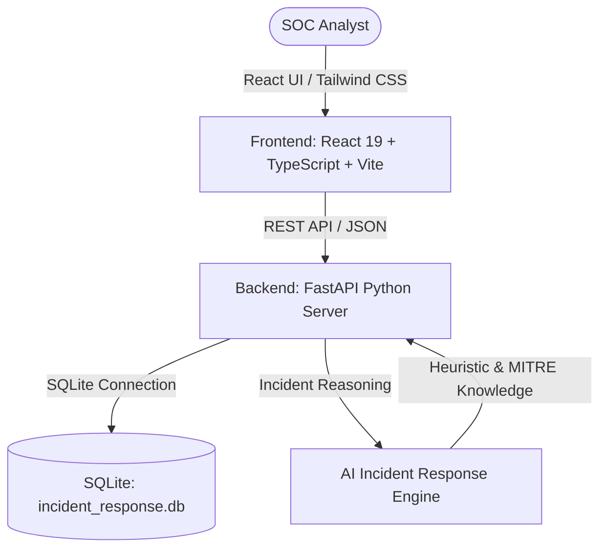

# 🛡️ Incident Response Agent
> **AI-Powered Security Incident Detection & Response Platform (SOC Simulation)**

[](https://fastapi.tiangolo.com)
[](https://react.dev)
[](https://tailwindcss.com)
[](https://www.sqlite.org)
[](https://attack.mitre.org)
[](#educational--safety-notice)

---

## 📌 1. Project Overview

**Incident Response Agent** is a full-featured, modern Security Operations Center (SOC) incident response and investigation platform. Designed for cybersecurity education and security operations training, it empowers analysts to detect, triage, investigate, prioritize, and remediate cybersecurity threats through an automated, AI-assisted workflow.

The platform provides an end-to-end incident management lifecycle following standard NIST SP 800-61 Rev. 2 and SANS response phases:
`Detection → Triage → Investigation → Containment → Eradication → Recovery → Lessons Learned`.

> ⚠️ **EDUCATIONAL & SAFETY NOTICE**: This project operates strictly in **Simulation Mode** using synthetic and simulated security telemetry. It does **not** conduct real cyberattacks, exploit systems, scan public IP ranges, or execute destructive commands on production infrastructure.

---

## ✨ 2. Key Features

- **📊 Modern SOC Dashboard**:
  - Top statistics: Total Incidents, Critical Incidents, Open Incidents, Resolved Incidents, and Average Response Time (MTTR).
  - High-fidelity interactive charts (Recharts): Severity distribution, 7-day incident trend, attack categories, and response pipeline status.
  - Live SOC sensors and Defcon threat level indicators.

- **🚨 Incident Management & Deep Investigation**:
  - Real-time search across ID, title, IP addresses, affected assets, and assigned analysts.
  - Multi-parameter filtering by Severity (`Critical`, `High`, `Medium`, `Low`), Status (`New`, `Investigating`, `Contained`, `Eradication`, `Recovery`, `Resolved`), and attack category.
  - Direct status modification and analyst assignment.

- **🤖 AI Incident Response Reasoning Engine**:
  - Prominent **"Analyze with AI"** one-click trigger.
  - Automatically synthesizes:
    - Executive incident summary.
    - Possible attack technique & MITRE ATT&CK attribution.
    - Rigorous severity reasoning & risk assessment.
    - Extracted Indicators of Compromise (IoCs).
    - Recommended Investigation, Containment, Eradication, and Recovery steps.
    - Institutional lessons learned.
  - Built-in contextual reasoning engine that operates 100% offline without external API dependencies.

- **🔄 Visual Incident Response Workflow Stepper**:
  - Visual 7-stage interactive pipeline (`Detection` to `Lessons Learned`).
  - Highlights the current stage with live pulse animation.
  - Allows analysts to progress incidents through stages while logging timestamps and analyst comments.
  - Displays stage-specific recommended actions and operational checklists.

- **🔔 Security Alert Triage Feed**:
  - Ingestion stream for simulated security alerts (e.g. *Failed login spike*, *Suspicious PowerShell execution*, *Malware dropper*, *Phishing email*, *Unusual outbound traffic*).
  - Confidence scoring meters (0–100%).
  - One-click actions: **Investigate**, **Dismiss** (false positives), and **Escalate to Incident** (automatically creates an incident ticket linked to the alert).

- **🧩 Indicators of Compromise (IoC) Intelligence**:
  - Catalog of simulated IPs, Domains, URLs, File Hashes (SHA-256), Email Addresses, Usernames, and Hostnames.
  - **"Analyze IoC"** modal providing simulated threat actor attribution, ASN/infrastructure context, reputation score, geolocation, and recommended firewall block actions.

- **📋 Interactive Response Playbooks**:
  - Standard Operating Procedures (SOPs) for:
    1. *Phishing Incident Response Playbook*
    2. *Malware Incident Response Playbook*
    3. *Brute Force Response Playbook*
    4. *Suspicious PowerShell Activity Playbook*
  - Interactive checklists with progress tracking and simulated action buttons (e.g., *Simulate EDR Host Isolation*, *Simulate Perimeter IP Block Rule*, *Simulate Mailbox Sweep*, *Simulate Credential Reset*).

- **💬 AI Security Analyst Chat Assistant**:
  - Dedicated conversational SOC assistant interface.
  - Context-aware: select any active incident to ask questions like:
    - *"Summarize this incident."*
    - *"What should I investigate first?"*
    - *"Why is this incident high severity?"*
    - *"What containment steps are recommended?"*
    - *"Show me the incident timeline."*
  - Mandatory educational disclaimer displayed with AI responses.

- **📄 Professional Incident Report Generator**:
  - Post-Action Review (PAR) compiler including Executive Summary, Detection Details, Chronological Timeline, Evidence Summary, IoCs, Containment Actions, and Strategic Recommendations.
  - Dedicated **Print / Export to PDF** view with clean white-background formatting.

- **📊 MITRE ATT&CK Enterprise Matrix Mapping**:
  - Maps simulated incidents directly to real-world MITRE ATT&CK techniques:
    - *Brute Force (T1110)*
    - *PowerShell (T1059.001)*
    - *Spearphishing Attachment (T1566.001)*
    - *User Execution (T1204.002)*
    - *Exfiltration Over C2 (T1041)*
    - *Privilege Escalation (T1068)*
    - *DNS C2 Beaconing (T1071.004)*
    - *Ransomware / Data Encrypted for Impact (T1486)*
    - *SSH Key Injection (T1098.004)*

- **⚙️ Settings & Demo Environment Reset**:
  - Analyst profile configuration.
  - One-click **"Reset Demo Environment"** button to restore default sample cybersecurity incidents, alerts, IoCs, and playbooks in the SQLite database.

---

## 🏛️ 3. Architecture & Tech Stack



### Technology Stack Details:
- **Frontend**: React 19, TypeScript, Vite 8, Tailwind CSS v4.
- **Charts**: Recharts (Pie/Donut, Area, and Bar charts).
- **Icons**: Lucide React.
- **Backend**: Python 3.14, FastAPI, Uvicorn ASGI server, Pydantic v2.
- **Database**: SQLite3 with JSON column support for rich evidence and timeline events.
- **Security & Safety**: Complete offline simulated environment with strict input validation.

---

## 🚀 4. Installation & Setup Guide

### Prerequisites
- **Node.js**: v18+ (v24+ recommended) and `npm`
- **Python**: v3.10+ (v3.14 supported) and `pip`

---

### Step 1: Clone or Navigate to the Repository
```bash
cd "c:\Incident response agent"
```

---

### Step 2: Set Up Backend (Python FastAPI)

1. Open a terminal and navigate to the `backend/` directory:
   ```bash
   cd backend
   ```
2. Install Python dependencies:
   ```bash
   pip install -r requirements.txt
   ```
   *(Or run: `pip install fastapi uvicorn pydantic`)*

3. Seed the database with initial simulated incident data:
   ```bash
   python seed_data.py
   ```

4. Start the FastAPI ingestion backend:
   ```bash
   python -m uvicorn server:app --host 127.0.0.1 --port 8000 --reload
   ```
   The backend API will be live at: **http://127.0.0.1:8000**  
   Interactive Swagger API docs available at: **http://127.0.0.1:8000/docs**

---

### Step 3: Start Real Data Telemetry Streamer

In a separate terminal, launch the live telemetry streamer:
```bash
python -u telemetry_streamer.py
```
This script monitors real authentication events and streams continuous attack telemetry samples directly into `http://127.0.0.1:8000/api/telemetry` with automated Gemini AI triage.

---

### Step 4: Set Up Frontend (React + TypeScript)

1. Open a third terminal and navigate to the `frontend/` directory:
   ```bash
   cd frontend
   ```
2. Start the Vite development server:
   ```bash
   npm run dev
   ```
   The application will be accessible at: **http://127.0.0.1:5173** (with live telemetry polling every 3 seconds and real-time containment).

---

## 📡 5. Backend REST API Documentation

| Method | Endpoint | Description |
| :--- | :--- | :--- |
| `GET` | `/api/dashboard` | Aggregated SOC statistics, severity distribution, and 7-day trend chart data |
| `GET` | `/api/incidents` | List all incidents (polled live every 3s by frontend) |
| `POST` | `/api/telemetry` | Ingest real/simulated telemetry with Gemini AI triage, MITRE ATT&CK mapping, and containment advice |
| `POST` | `/api/contain/{id}` | Mark target incident as **'Remediated (Blocked)'** and log containment action |
| `GET` | `/api/incidents/{id}` | Retrieve comprehensive incident details, timeline, and forensic evidence |
| `POST` | `/api/incidents` | Create a new simulated incident record |
| `PUT` | `/api/incidents/{id}` | Update incident fields (status, assigned analyst, description) |
| `DELETE` | `/api/incidents/{id}` | Delete an incident record |
| `POST` | `/api/incidents/{id}/workflow` | Advance incident workflow stage (`Detection` → `Triage` → `Investigation` → ...) |
| `POST` | `/api/analyze-incident` | Execute AI Incident Response agent analysis on incident telemetry |
| `GET` | `/api/alerts` | List all incoming security alerts |
| `POST` | `/api/alerts/{id}/action` | Take triage action on alert: `investigate`, `dismiss`, or `escalate` |
| `GET` | `/api/iocs` | List simulated Indicators of Compromise (IP, Hash, Domain, etc.) |
| `POST` | `/api/analyze-ioc` | Threat intelligence analysis on an Indicator of Compromise |
| `GET` | `/api/playbooks` | List standard incident response playbooks and checklists |
| `POST` | `/api/playbooks/{id}/execute-step`| Execute or toggle playbook step; records simulated action in incident timeline |
| `POST` | `/api/chat` | AI Security Assistant conversational Q&A endpoint |
| `POST` | `/api/generate-report` | Generate comprehensive post-action executive & technical report |
| `GET` | `/api/mitre` | Retrieve MITRE ATT&CK technique mappings |
| `GET` | `/api/settings` | Read current system settings |
| `PUT` | `/api/settings` | Save analyst preferences |
| `POST` | `/api/reset-demo` | Restore fresh baseline simulated database |

---

## 🧪 6. Sample Simulated Data Included

The database includes over 10 realistic simulated cybersecurity scenarios:
1. **IR-1001**: *Brute Force Login Attempt* (`192.168.1.25` targeting internal domain administrator accounts)
2. **IR-1002**: *Suspicious PowerShell Activity* (Base64 encoded download cradle invoking IEX and contacting C2)
3. **IR-1003**: *Phishing Email Delivery & Click* (Deceptive executive payroll lure with credential harvester URL)
4. **IR-1004**: *Malware Detection (Trojan Dropper)* (`Trojan.SimGeneric` dropper in `%APPDATA%\Local\Temp`)
5. **IR-1005**: *Multiple Failed Logins (Internal VPN)* (Internal misconfiguration false positive)
6. **IR-1006**: *Data Exfiltration Simulation* (`14.8 GB` bulk egress via `rclone_sim.exe` over HTTPS)
7. **IR-1007**: *Privilege Escalation Simulation* (Token impersonation from standard user to `NT AUTHORITY\SYSTEM`)
8. **IR-1008**: *Suspicious DNS Beaconing* (High-entropy periodic queries every 60s to `sim-c2-beacon.xyz`)
9. **IR-1009**: *Ransomware Staging Activity* (`vssadmin delete shadows` halted by canary file guard)
10. **IR-1010**: *Unauthorized SSH Key Injection* (`/root/.ssh/authorized_keys` injection on Linux host)

---

## 🔒 7. Project Limitations & Safety Boundary

1. **Simulated Telemetry**: All hostnames, IP addresses (RFC 1918 / RFC 5737 test ranges `198.51.100.0/24`), usernames, and process commands are synthetic examples for safe educational study.
2. **No Active Exploitation**: The platform contains no active exploit code, payloads, or network scanner agents.
3. **Local AI Engine**: Uses a deterministic rule-based cybersecurity reasoning engine ensuring zero data leakage and instantaneous offline response without requiring third-party API keys.

---

## 🔮 8. Future Enhancements

- Integration with live open-source SIEMs (e.g. Wazuh, Elastic Security) via webhook receivers.
- Sigma rule and YARA rule generator within the Eradication phase.
- Multi-analyst collaborative incident chat rooms using WebSockets.
- STIX/TAXII 2.1 threat feed export for IoCs.
- Automated email notification dispatch for critical escalations.

---

## 👨‍💻 Author & Project Context
Built as an educational cybersecurity platform and Security Operations Center (SOC) management tool demonstrating modern agentic AI assistance in incident handling and response.
